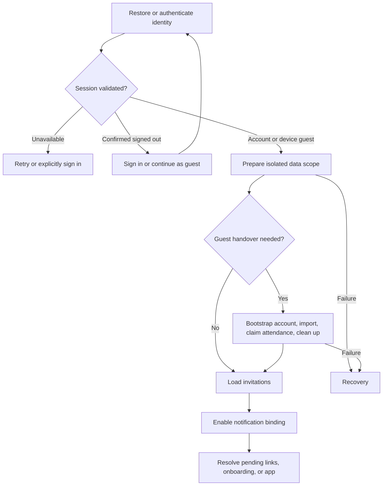

# Mobile sign-in and session lifecycle

October 20, 2026. Implemented locally in the iOS repository; no deployment or
commit is implied by this document. Better Auth remains the identity authority.

## Design

Use a **pure Chain of Responsibility for entry routing** and an **observable
preparation coordinator for asynchronous work**. Routing answers which screen
can be shown. Preparation owns opening the data scope and completing guest
handover. Credential validation remains in `AuthenticationSession`. Handlers
never perform network requests, claim invitations, delete records, or grant
permissions.

The native ownership boundaries are:

| Component | Responsibility |
| --- | --- |
| `AuthenticationSession` | Credentials, validated account, device guest identity, restoration errors, and explicit exit actions. |
| `AuthenticationFlowChain` | Ordered pure handlers returning an explicit destination. An incomplete custom chain fails closed. |
| `SessionPreparationCoordinator` | `idle`, `preparing`, `ready`, or `recovery`, scoped to a typed account/guest identity and a generation. |
| `LiveSessionPreparationServices` | Existing persistence, sync, attendance claim, invitation cache, and notification integrations. |
| `SessionLifecycleActions` | Shared save-before-authentication and teardown hooks for all sign-in providers and exit paths. |
| `GatheroryLaunchContainer` | Rendering destinations, splash timing, user actions, and authorized notification navigation. |

Entry routing prioritizes restoration and incomplete guest removal, explicit
guest sign-in, retained guest import/recovery, storage preparation failures,
pending blueprint/invitation links, guest/signed-out entry, and account
preparation. Once the correct account is ready, invited attendees can enter
directly. Ordinary remote account onboarding still passes through authenticated
bootstrap and invitation loading/error checks; the explicit QA onboarding
override remains available.

Add a routing policy by implementing `AuthenticationFlowHandler` and placing it
in the explicit default order, with tests proving precedence over neighboring
policies. Add asynchronous work to the preparation services/coordinator at its
required boundary, with cancellation checks and failure tests. Avoid side
effects in routing handlers and avoid introducing a second authentication or
permissions model.

## Retention and isolation

| Situation | Result |
| --- | --- |
| Restoring a credential fails because of network or storage | Show recovery and retry; preserve credentials, account archives, and any retained guest profile. Do not infer sign-out or manufacture a validated user. |
| Credential is absent or confirmed expired | Show authentication; account archives remain isolated on disk. |
| Device guest enters | Open only the guest namespace; no authenticated planning sync. Guests attend as guests and sign in to help plan. |
| Guest signs into an existing account | Save guest edits first, bootstrap the account, add guest plans using the existing durable import receipt, claim attendance, then clean up the source. Existing account data and event roles win. |
| Import was started for another account | Require the original account; retained source editing stays blocked. |
| Guest claim/import is interrupted | Retain source/profile/proof and receipt for retry. Do not enable account notification binding before handover finishes. |
| Account signs out with pending work | Attempt final sync while authenticated; preserve the existing retry/stay/explicit keep-on-device choices. |
| Guest removal fails after partial cleanup | Keep an explicit recovery gate. Explain that some device data may already have been removed; retry idempotent cleanup before reopening the app. |
| Server confirms account deletion but local removal fails | Keep the captured account ID in a durable cleanup journal; retry local stores on launch before any account or guest preparation. Never repeat remote deletion or upload pending work. |
| A stale preparation finishes after A → B → A | Generation and current-identity checks prevent it from publishing readiness, deleting the retained source, or binding notifications for the later session. |

Onboarding completion uses the active account's sync state and positive
per-account cache. The old device-global `hasCompletedOnboarding` preference
no longer chooses entry for another account. Session-only QA completion is
scoped to the current identity. Skipping event creation also remains complete
for that account in local fixture mode without creating a workspace.

Storage/import/outbox transactions, server permissions, and verified attendance
claim semantics are unchanged by the structural extraction. Guest transfer
cleanup still occurs only after durable import and successful claim. A new
profile-removal recovery state prevents the retained profile from reopening an
already-cleared or unowned data scope.

## Verification and remaining acceptance

Use the iOS `GatheroryTests` target only and run
`bash scripts/verify-localizations.sh`. Tests cover routing precedence,
unavailable versus expired restoration, all provider save gates, account-scoped
onboarding, cancellation at suspended steps, A → B → A preparation, guest
handover ordering, sign-out retention, and installed lifecycle hooks against
in-memory SwiftData. Automated UI tests are excluded for this change.

Final local verification: **790 tests across 108 suites passed**, plus English
and Spanish coverage for **1,384 strings**. The native
[verification record](../../../ios-apps/gatherory/docs/testing-verification.md)
contains the command, log, and result bundle. The web repository has documentation
changes only for this refactor; no server contract, migration, or deployed
identity configuration changed.

Physical-device acceptance still needs:

- Offline cold launch with a retained account credential: recovery appears,
  reconnect/retry opens the same account without exposing another scope.
- Guest plans plus attendance → sign in to an existing populated account;
  interrupt the claim once, retry with the same account, then check both sets
  of information and original roles.
- Wrong-account handover recovery and explicit guest removal/cancellation.
- Sign-out with offline edits/media, staying signed in after failure, and the
  explicit keep-pending-on-device choice followed by same-account sign-in.
- Pending invitation/blueprint link and notification tap during preparation;
  no screen from the previous account should appear.
- Apple/Google cancellation and email-verification-required registration.

The subsequent deletion cleanup slice is implemented locally: sync is suspended
and joined before deletion, and an atomic account-ID/phase journal is retained
until exact-account persistence, media, invitation, blueprint, preference, and
credential cleanup completes. Independent store failures do not skip other
cleanup steps. Confirmed cleanup resumes before session restoration. Other
accounts and device guest sources remain intact. A lost remote response is a
separate unconfirmed state requiring explicit device-only removal, with a
distinct durable phase; it never retries the remote request or asserts the
server account was deleted. The native authentication contract has details.

Deletion cleanup verification passed **825 native non-UI tests in 116 suites**
and localization checks for **1,394 English/Spanish strings**. See the native
verification record for the command and evidence. No UI tests were run, and
neither repository was committed or deployed.

Physical-device deletion acceptance still needs a disposable account: confirm
deletion, interrupt local cleanup/relaunch, retry it, then verify another
account and retained guest sources are untouched. Also check server rejection,
an interrupted response, the explicit local-only removal choice, and same-account
sign-in if the server account still exists. No real account was deleted during
automated verification.

This slice does not add offline authentication from an unvalidated cached
profile. Broader onboarding copy/layout changes and cross-device
completion of a skipped welcome flow require their own product decision.

See the native [authentication contract](../../../ios-apps/gatherory/docs/auth-integration.md)
and [offline sync guide](../../../ios-apps/gatherory/docs/offline-sync.md).
