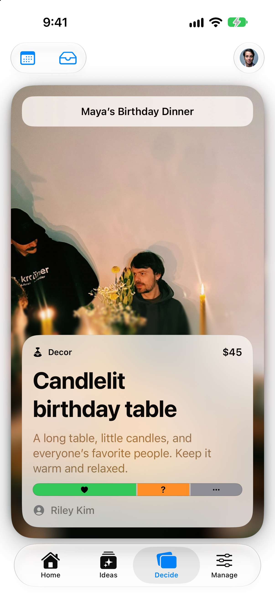
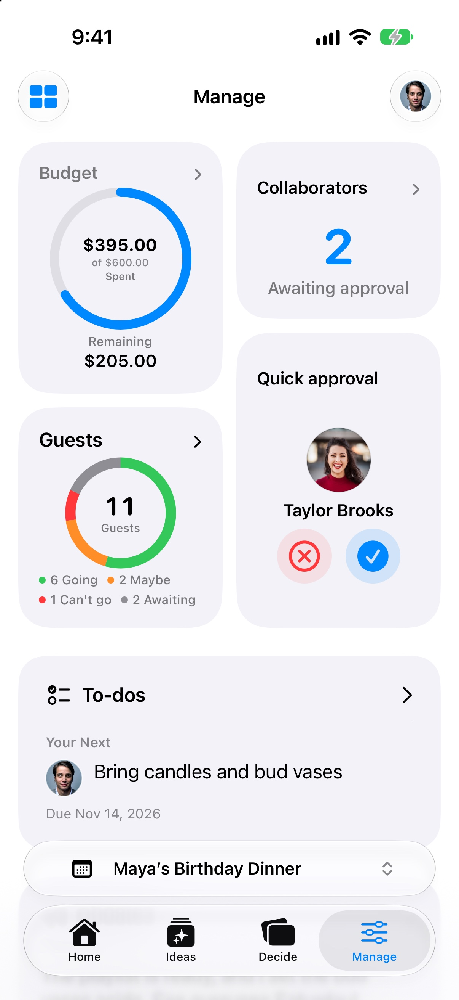

# Reddit screenshot pack

Prepared October 23, 2026. **Local only; nothing posted, uploaded, or scheduled.**

The owner chose to reuse the existing App Store/landing artwork after review.
The two selected JPEGs below are byte-for-byte copies of the existing English
iPhone App Store preparation images. They use the same **Maya’s Birthday Dinner**
sample, light appearance, native aspect ratio, and 9:41 status bar. No cropping,
phone frames, text overlays, retouching, or recompression was applied.

## Selected attachments

Use **Decide first, then Manage** wherever the live submission format supports
image attachments and publication is separately authorized. The owner confirmed
that r/SideProject offers Text, Link, and Video with no image-post option; use
its Text draft, without an image gallery. These files can support a future
video, but no video has been prepared. For r/TestFlight, keep the direct TestFlight destination;
do not add image-host links. The [post preparation notes](../README.md) record
the community guidance.

| Order | File | Dimensions | Caption |
| --- | --- | --- | --- |
| 1 | [Decide](01-decide.jpg) | 1206 × 2622 | Sample birthday dinner: compare the team’s reactions to ideas. |
| 2 | [Manage](02-manage.jpg) | 1206 × 2622 | Same sample dinner: track guest responses, collaborator requests, budget, and the next task. |

Alt text for Decide:

> Decide screen for Maya’s Birthday Dinner showing a $45 candlelit table idea,
> its description, and the team response bar.

Alt text for Manage:

> Manage screen for Maya’s Birthday Dinner showing $395 of a $600 budget spent,
> $205 remaining, 11 guests across four RSVP categories, two pending collaborator
> requests, Taylor Brooks’ quick approval card, and the task Bring candles and
> bud vases, due November 14, 2026.

## Visual review

Two Luna agents handled fixture/capture investigation and independent visual
review. The existing artwork fits the requested story:

- Decide keeps the sample event name, candlelit-table photograph, Decor
  category, $45 cost, title, description, contributor, response bar, and bottom
  navigation readable. Its bar uses symbols rather than explicit reaction
  names or counts; the caption does not claim those labels/counts are visible.
  The contributor uses the app’s standard person icon on this surface.
- Manage shows the complete budget ring and amounts, all four guest categories
  (6 Going, 2 Maybe, 1 Can’t go, 2 Awaiting), two collaborators awaiting approval,
  Taylor’s portrait and quick approval controls, and Alex’s pictured next task.
  The task title and due date are visible. The floating event selector covers
  lower content beyond the task; this image does not show the full Updates card.
- Both are fictional fixture content with stock prototype photography and
  portraits, not customer activity, real approvals, or testimonials.
- The full-resolution JPEGs preserve the phone UI for readers who open an
  image. Avoid shrinking them into a small side-by-side composite.

## Sources and verification

The originals remain in the landing repository:

- [Decide source](../../../../../gatherory-landing/docs/app-store-release/screenshots/en-US/03-decide.jpg)
- [Manage source](../../../../../gatherory-landing/docs/app-store-release/screenshots/en-US/04-manage.jpg)
- [Original capture report](../../../../../gatherory-landing/docs/app-store-release/screenshots/screenshot-capture-report.md)
- [Original visual review](../../../../../gatherory-landing/docs/app-store-release/screenshot-visual-review.md)
- [Fixture/photo inventory](../../../../../ios-apps/gatherory/docs/birthday-marketing-fixture-assets.md)

The original report dates these to October 22, 2026: isolated Debug simulator
previews on iPhone 18 Pro / iOS 27.0, using an ephemeral birthday fixture.
They are not release-build exports or evidence of the currently available
TestFlight build. Confirm that build’s behavior before publishing claims about
it. The Spanish and iPad variants remain in the original release folder; this
pack selects the English iPhone pair for the English Reddit drafts.

[manifest.json](manifest.json) records source paths, dimensions, sizes, and
SHA-256 hashes. Preparation verified JPEG dimensions and byte-for-byte equality
with the source files, and checked the local documentation links. This task
made no native UI, fixture, database, landing-image, or asset-baseline changes.

## Current-source comparison, not selected

Before the owner chose to reuse existing artwork, the capture agent completed
a fresh [Decide reference PNG](reference-only/2026-10-23-decide-current-source.png)
from native commit `abc7091c3c9471105d6ed0eba64490852352657b` (Build 5), with a
successful Debug build in `/tmp/gatherory-reddit-capture-build`. This reference
is retained separately so it cannot be confused with the selected JPEG pair.
No new Manage capture was needed after the artwork selection.

It used iPhone 18 Pro / iOS 27.0 and these launch arguments:

```text
-DisableProductionFlowSimulation -SeedDevelopmentData -SkipAuthentication
-UseEphemeralDataStore -UseBirthdayMarketingFixture -UseProductionOnboarding
-AuthenticationBaseURL http://127.0.0.1:9
-AppleLanguages '(en)' -AppleLocale en_US
```

The app rendered the in-memory sample with analytics disabled. No server seed,
persistent database reset, or real account was used. The agent terminated the
app, cleared its temporary status-bar override, and shut down the simulator;
the build completed and has no lingering process. Native Git status remained
clean. Temporary build products remain at the path above.




